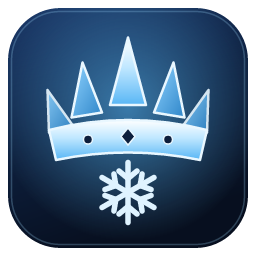

<h1 align="center">FrozenKingdom</h1>

Hunter's WoW: Forever addons and apps, installed and kept up to date for you.

## Install

1. Open the **[latest release](../../releases/latest)** and download `FrozenKingdom_x.y.z_x64-setup.exe`.
2. Run it. If Windows says **"Windows protected your PC"**, click **More info → Run anyway**
   (the installer isn't code-signed).
3. FrozenKingdom finds your WoW: Forever folder by itself. Click **Install** on the addons you want,
   then type `/reload` in game.

FrozenKingdom updates itself and your addons. It lives in the tray (by the clock) so prices and
updates keep coming while it's closed.

## What's inside

- **WoW Forever addons**: Forever Market (auction prices, synced automatically), LootRoll (a clearer
  Need/Greed/Pass window with everyone's rolls and animated dice), CrispText, Compass Ribbon
- **Applications**: Refract (multi-stream Twitch client)
- A gold **Play** button that updates your addons and starts WoW: Forever
- A page for every project: all versions (roll back if an update breaks something), automatic
  settings backups before updates with one-click restore, and commands you can copy into chat
- **Patch notes** and **Update** buttons at the top; FrozenKingdom updates itself
- A **Console** that shows exactly what happened if anything goes wrong
  (Settings › Advanced › Copy diagnostics makes a bug report easy)
- Themes, falling snow, and lots of settings

## Already using Forever Market's "Enable Auto-Sync"?

Open FrozenKingdom › **WoW Forever** and click **Switch over**. The old helper is removed and your
price history is kept.

---

`catalog.json` lists every project FrozenKingdom offers. Prices from AHledger (ahledger.com).
